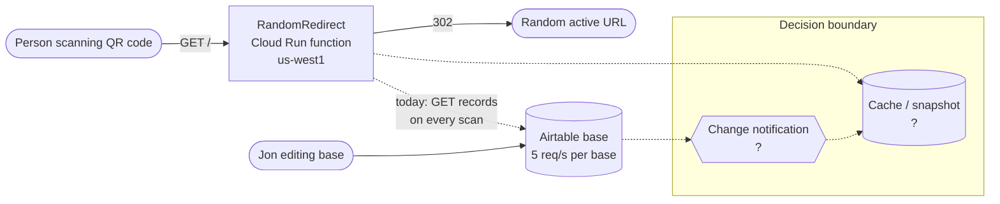
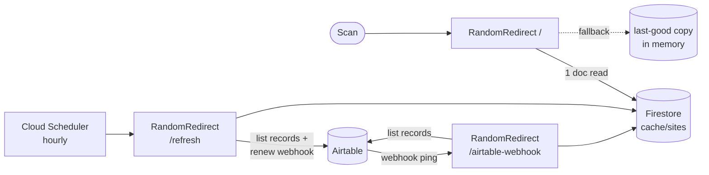
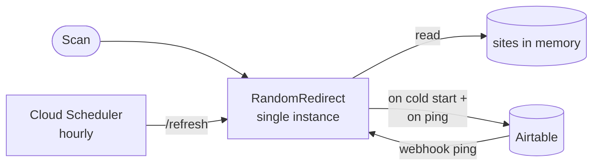
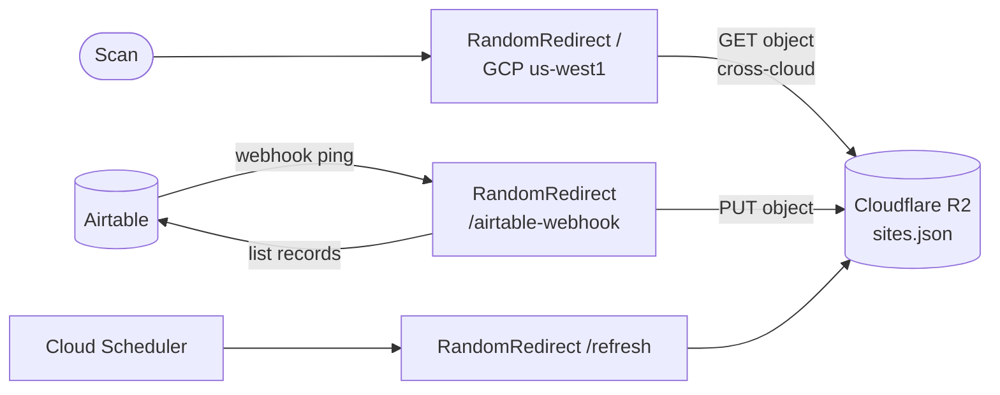
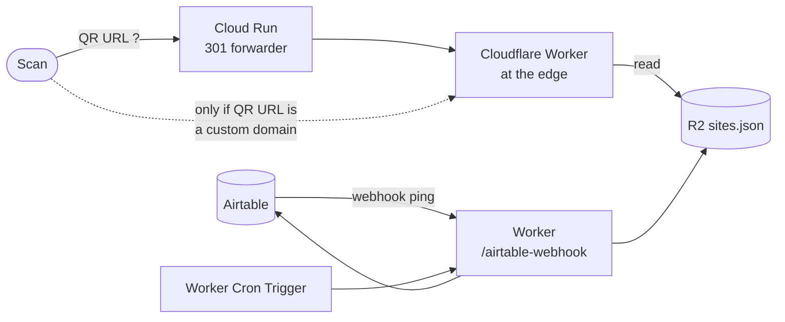

# AA: Caching layer between Airtable and the random-redirect function

## Metadata

| Field | Value |
|---|---|
| Summary | Choose how to put a cache between Airtable and the `RandomRedirect` Cloud Run function. The goals are that QR scans never trigger Airtable rate-limit errors and that Airtable edits reach the cache within seconds. |
| Created | 2026-10-21 |
| Status | FINAL (superseded) |

> **Superseded on 2026-10-21** by [Replacing Airtable](replace-airtable.md). The real constraint turned out to be Airtable's monthly API cap, not the per-second limit, so the redirect list moved to Google Sheets.

## Background

`RandomRedirect` (`function.go`) is a Cloud Run function (gen2, Go 1.25, `us-west1`). The QR codes encode its URL. On **every** request it:

1. builds an Airtable client from `AIRTABLE_API_KEY` / `AIRTABLE_BASE_ID` / `AIRTABLE_TABLE_ID` (Secret Manager);
2. calls `table.GetRecords().Do()`;
3. keeps records with `Active == true` and a non-empty `URL`;
4. returns a 302 redirect to a randomly chosen record (or an HTML list with `?debug`).

**Problem.** Airtable allows **5 requests/second per base**. When a client goes over that limit, Airtable returns `429` and blocks further requests for about 30 seconds. One scan makes one Airtable call. So a burst of scans (a poster at an event, say, or a crawler following the QR URL) trips the limit, and then every scan fails with a 500 for about 30 seconds. Upgrading the Airtable plan doesn't help, because the per-base limit is the same on every plan.

**Secondary defect.** `GetRecords().Do()` returns only the first page (100 records), so any active record after the 100th is silently never chosen. Every alternative below fixes this by paging with `WithOffset` during refresh.

**Requirements.**

- **R1.** The scan path never calls Airtable, so scan volume can't cause a rate-limit error.
- **R2.** Edits in the Airtable base show up in redirects within seconds, not after a TTL expires.
- **Constraint.** The URL printed in the QR codes stays the same, or keeps working. Printed codes can't be reissued.

### AA trigger check

| Trigger | Applies? |
|---|---|
| New technology | Yes. It adds a datastore and Airtable webhooks. |
| Cross-team impact | No. There's one owner. |
| Data architecture change | Yes. A copy of the Airtable data becomes the source the scan path reads. |
| Hard-to-reverse decision | Maybe. That's true only for alternatives that move off Cloud Run, because of the QR URL constraint. |
| Structural refactoring | Maybe. The function gains webhook and refresh routes. |

At least one trigger applies, so an AA is warranted.

### Context diagram

## Decision

Adopt **Alternative 1: a Firestore snapshot, refreshed by an Airtable webhook, with an hourly reconcile job**. It has the highest weighted score (4.45 / 5). It's the only alternative that meets both R1 and R2 without depending on Cloud Run's instance count, without adding a second cloud, and without changing the QR URL. **Alternative 2 (an in-memory cache with `max-instances=1`) scored a close second (4.30).** It's the right choice if fewer moving parts matter more than guaranteed freshness across instances (see Robustness). Alt 1 ranks first in 95–100% of 10,000 randomised weightings, so the decision is robust even though the raw margin counts as close.

## Proposal

**Alternative 1: Firestore snapshot + Airtable webhook + reconcile job.**

1. **Snapshot.** One Firestore (Native mode) document, `cache/sites`, holds `{sites: [{name, url}], refreshedAt, webhookCursor}`. It's well under the 1 MiB document limit even with thousands of rows.
2. **Scan path (`/`).** The function reads `cache/sites`, which is a single document read, typically 5–15 ms within the same region. It picks a random site and redirects. It keeps the last good snapshot in memory and serves that if Firestore is unavailable. If the document doesn't exist yet (first deploy), it does one refresh from Airtable to fill it.
3. **Refresh routine.** It pages through all records with `WithOffset`, filters `Active && URL != ""`, and writes the snapshot. That takes one Airtable call per 100 records. A Firestore transaction stops two refreshes that run at the same time from overwriting each other with older data.
4. **Push (`POST /airtable-webhook`).** A webhook registered through the Airtable Webhooks API on the table (`dataTypes: tableData, tableFields`) pings this route on any change. The handler:
   - verifies `X-Airtable-Content-MAC` (HMAC-SHA256 with the webhook's `macSecretBase64`, stored in Secret Manager);
   - drains `GET /v0/bases/{base}/webhooks/{id}/payloads?cursor=…`, which acknowledges the ping and extends the webhook's 7-day expiry;
   - runs the refresh routine.

   Edits are typically visible in redirects within about 1–5 seconds.
5. **Safety net (`POST /refresh`).** Cloud Scheduler calls this hourly with an OIDC token. It runs the refresh routine (in case a ping was lost) and calls `POST …/webhooks/{id}/refresh` so the webhook never expires during a quiet week.
6. **One-time setup command.** `go run ./cmd/registerwebhook` creates the webhook and prints the ID and MAC secret to store as secrets.
7. **Routing.** All three routes stay in the existing `RandomRedirect` entry point, switched on path and method, so `cloudbuild.yaml` keeps one deploy step and the QR URL is unchanged.

**Setup Jon does himself:** create a Firestore Native database in `us-west1`; grant the function's service account `roles/datastore.user`; add the `webhook:manage` scope to the Airtable PAT (or create a second PAT for registration); run the registration command; add the `AIRTABLE_WEBHOOK_ID` and `AIRTABLE_WEBHOOK_MAC_SECRET` secrets and reference them in `cloudbuild.yaml`; create the hourly Cloud Scheduler job.

**Trigger variant considered:** an Airtable Automation ("When record updated → Run script → `fetch` /refresh") instead of the Webhooks API. It's simpler to set up (no MAC, no expiry), but automation run quotas depend on the plan, and the "Run script" action isn't available on every plan. The Webhooks API works on every plan. Either trigger works with every alternative below, so the choice doesn't affect the scores.

## Consequences

### Cost Estimate

Horizon: 6 months of development, 5–10 years of infrastructure. Traffic assumption: at most 30,000 scans/day (stated as an assumption; actual scan volume is unknown). Development is Jon's own time, so it's given in hours rather than dollars. Prices are 2026 list prices, and free tiers apply per billing account.

| | Option 1: Firestore + webhook | Option 2: In-memory, 1 instance | Option 3: Cloudflare R2 snapshot | Option 4: Cloudflare Worker + R2 |
|---|---|---|---|---|
| Dev effort (Claude builds; Jon reviews and sets up) | ~2 h of Jon's setup/review | ~1 h | ~2.5 h | ~5 h, plus a QR URL migration plan |
| Infra per month | $0. Firestore free tier is 50k reads/20k writes per day; Scheduler has 3 free jobs. Beyond that, about $0.03–0.04 per 100k scans. | $0. No new services. | $0. R2 includes 10M Class-B reads per month free. Cross-cloud egress from GCP for the small requests is negligible. | $0–5. Workers free tier is 100k requests/day; the paid plan is $5/month. |
| Infra over 10 years | ≈ $0 | ≈ $0 | ≈ $0 | $0–600 |
| **Total Cost** | **~2 h, ≈ $0** | **~1 h, ≈ $0** | **~2.5 h, ≈ $0** | **~5 h, $0–600** |
| **Cost Savings** (vs. today) | Not monetary. It removes the failed scans during 429 windows. Upgrading the Airtable plan wouldn't have fixed this, so there's no plan upgrade to avoid paying for. | Same | Same | Same, plus Cloud Run's per-request cost drops to $0 if Cloud Run is retired |

### Positive Impacts

- Scans no longer call Airtable at all, so Airtable rate limits stop affecting scans.
- Edits show up within seconds, and the hourly reconcile catches any missed ping.
- Scans stay fast (a Firestore read is far quicker than the current Airtable round trip of 200–500 ms or more).
- Fixes the 100-record pagination bug.
- If Airtable is down, scans keep working from the last snapshot.
- Uses the function's own Google identity for Firestore, so there are no new long-lived keys for the cache.

### Negative Impacts

- Adds three new pieces to operate: a Firestore database, the webhook (plus its MAC secret), and a Scheduler job.
- The function gains two non-scan routes. `/airtable-webhook` is public, but it's protected by HMAC.
- If both the webhook and the reconcile job fail, edits wait until the next successful refresh (worst case about 1 hour).
- The scan path now depends on Firestore. This is mitigated by the in-memory last-good copy.

## Analysis

### Alternative 1: Firestore snapshot + webhook + reconcile (proposed)

**Pros**
- Meets R1 and R2 no matter how many Cloud Run instances run: every instance reads the same document.
- Stays inside GCP, so there's no new cloud account, no new keys, and no change to the QR URL.
- New or cold-started instances read Firestore, not Airtable.
- Easy to reverse: removing Firestore and going back to direct calls is a small diff.

**Cons**
- The most moving parts of the GCP options.
- Adds a Firestore read (about 10 ms) to each scan, compared with memory.
- Webhook registration and the expiry renewal are non-obvious and need documenting.

### Alternative 2: In-memory cache, `max-instances=1`, webhook refresh

The instance loads the table into a package-level variable on cold start, and the same webhook and reconcile routes replace it. `--max-instances=1` makes sure the instance that gets the webhook is the one serving scans.

**Pros**
- Fewest parts: no datastore. Fastest possible scan path.
- Nothing to provision except the webhook secret and the Scheduler job.

**Cons**
- Cloud Run can briefly run more than `max-instances` during deploys and scaling events. A second instance would miss the ping and serve stale data until its next refresh, which partly breaks R2.
- Every cold start (after scale-to-zero, which happens often at QR traffic levels) calls Airtable. That's far fewer calls than today, but not zero, so R1 is only mostly met.
- One instance caps throughput (80 concurrent requests by default). That's ample for QR codes, but it's a ceiling.
- If Airtable is down during a cold start, there's no snapshot to fall back on.

### Alternative 3: Cloud Run reads a snapshot from Cloudflare R2

Same as Alternative 1, but the snapshot is an R2 object (R2 has strong read-after-write consistency). This reuses Jon's existing Cloudflare account.

**Pros**
- Meets R1 and R2 across any number of instances.
- Generous free tier, and Jon already uses R2.

**Cons**
- Every scan makes a cross-cloud HTTPS call (about 30–80 ms, compared with about 10 ms for Firestore in the same region).
- Needs R2 access keys stored as Secret Manager secrets, which means more long-lived credentials to rotate.
- Two clouds to watch when something breaks.

### Alternative 4: Move the redirect to a Cloudflare Worker with an R2 snapshot

The function is rewritten as a Worker (JS/TS). The snapshot lives in R2, which is strongly consistent. Workers KV was rejected because propagation takes up to about 60 seconds, which fails R2. A Worker Cron Trigger replaces Cloud Scheduler.

**Pros**
- Runs at the edge with no cold starts, so it's the fastest scan path if the QR URL can point at the Worker.
- Everything is on one platform, which Jon already uses.

**Cons**
- **QR URL constraint:** the printed codes point at the Cloud Run URL. Unless they encode a custom domain that can be re-pointed, Cloud Run has to stay up as a forwarder. That adds a hop and cancels most of the benefit.
- A full rewrite in a different language plus a new deploy pipeline. That's the most effort and the hardest to reverse.
- The Airtable PAT moves to a new platform.

### Rejected without full scoring

- **Short-TTL in-memory cache only:** fails R2 by definition. Also, every instance still calls Airtable once per TTL, which reduces R1 failures without guaranteeing none.
- **Workers KV as the snapshot:** eventually consistent (about 60-second global propagation), so it fails R2.
- **Memorystore (Redis):** costs at least about $35/month and needs a VPC connector. It's more than this workload needs.

### Decision Matrix

Scores are integers 1–5, where **5 is always the most desirable**. Cost, effort, latency, and lock-in are inverted so that a lower raw value scores higher. Weights sum to 1.00. The weighted total is Vⱼ = Σ(Wᵢ × Sᵢⱼ).

| Evaluation Criteria | Group | Weight | Alt 1: Firestore + webhook | Alt 2: In-memory, 1 instance | Alt 3: R2 from Cloud Run | Alt 4: Worker + R2 |
|---|---|---|---|---|---|---|
| C1. Scan path never calls Airtable (R1) | Functional fit | 0.20 | 5 | 4 | 5 | 5 |
| C2. Edit propagation latency (R2) | Functional fit | 0.20 | 5 | 4 | 5 | 5 |
| C3. Infra cost over 10 years (inverted) | Business | 0.10 | 5 | 5 | 5 | 4 |
| C4. Implementation effort and time to ship (inverted) | Business | 0.10 | 3 | 4 | 3 | 2 |
| C5. Scan latency (inverted) | Quality | 0.10 | 4 | 5 | 3 | 4 |
| C6. Reliability and failure modes | Quality | 0.10 | 4 | 3 | 4 | 4 |
| C7. Security: secrets and attack surface | Quality | 0.05 | 5 | 5 | 3 | 4 |
| C8. Day-2 ops and observability | Operational fit | 0.10 | 4 | 5 | 3 | 2 |
| C9. Reversibility and lock-in (inverted) | Operational fit | 0.05 | 4 | 5 | 4 | 2 |
| **Total Weighted Score** | | **1.00** | **4.45** | **4.30** | **4.15** | **3.90** |

#### Score anchors

| Criterion | 1 | 3 | 5 |
|---|---|---|---|
| C1 | Airtable is called on most scans | Airtable is called occasionally (e.g. on cold start or TTL expiry) | Airtable is never called on the scan path |
| C2 | Minutes or longer (TTL-bound) | Seconds, but some instances or edge cases can lag | Seconds, consistent for every scan |
| C3 | More than $50/month | $1–10/month | $0 (inside free tiers) |
| C4 | Rewrite, new language or pipeline, more than 4 h | New component in the existing codebase, 2–3 h | Configuration plus a small code change, under 1 h |
| C5 | More than 200 ms added | 30–80 ms added | Under 5 ms added (memory or edge) |
| C6 | Scans fail whenever Airtable is down or throttled | Survives one dependency failing, with caveats | Last-good fallback, no single point of failure, self-healing |
| C7 | New long-lived keys on a new platform plus new public surface | One new long-lived key | No new long-lived keys; new routes authenticated |
| C8 | Two platforms plus a new pipeline to monitor | One platform with several new components | No new components to monitor |
| C9 | Hard to reverse; QR URL or platform migration | New dependency removable with a moderate diff | Trivial to undo (a flag or one small diff) |

Scores of 2 and 4 sit between the neighbouring anchors.

#### Robustness

All figures come from [`airtable-cache-robustness.py`](airtable-cache-robustness.py). It uses seed `20261021` and needs numpy.

**1. Dominance.** No alternative dominates. Alt 1 scores higher than Alt 2 on C1, C2 and C6, and lower on C4, C5, C8 and C9. So the result depends on the weights, and the checks below are needed.

**2. Winning margin.** Alt 1 leads Alt 2 by Δ = 4.45 − 4.30 = **0.15**. Normalised by the score range, Δ̄ = 0.15 / (5 − 1) = **0.0375**. That's below 0.05, so the margin counts as **close**, and the spec requires the Monte Carlo check with at least 10,000 trials.

**3. Flip points.** The table shows, for each criterion, the smallest change δₖ to its weight that would put Alt 2 ahead of Alt 1. The other weights are rescaled so the total stays 1. dₖ is Alt 1's score minus Alt 2's on that criterion.

| Criterion | Wₖ | dₖ | δₖ | Weight at which Alt 2 takes the lead | \|δₖ\| / Wₖ |
|---|---|---|---|---|---|
| C1. Scan path never calls Airtable | 0.20 | +1 | −0.141 | 0.059 | 0.71 |
| C2. Edit propagation latency | 0.20 | +1 | −0.141 | 0.059 | 0.71 |
| C3. Infra cost | 0.10 | 0 | — (cannot flip) | — | — |
| C4. Implementation effort | 0.10 | −1 | +0.117 | 0.217 | 1.17 |
| C5. Scan latency | 0.10 | −1 | +0.117 | 0.217 | 1.17 |
| C6. Reliability | 0.10 | +1 | −0.159 | infeasible (weight would go below 0) | — |
| C7. Security | 0.05 | 0 | — (cannot flip) | — | — |
| C8. Day-2 ops | 0.10 | −1 | +0.117 | 0.217 | 1.17 |
| C9. Reversibility | 0.05 | −1 | +0.124 | 0.174 | 2.48 |

The most critical criteria are **C1 and C2**. For Alt 2 to take the lead, either one's weight has to drop from 0.20 to about 0.06, which is 71% of its base weight. On the other side, C4, C5 or C8 would each have to more than double, from 0.10 to about 0.22. None of these flip points is a small fraction of its weight, so **no single contestable weight decides the outcome**.

Changing several weights at once can still flip the result. For example, moving 0.05 from each of C1 and C2 onto C4 and C8 (making all four 0.15) gives Alt 2 4.35 against Alt 1's 4.30. So the result still comes down to one judgement: how much do the stated requirements (R1 and R2) matter compared with simplicity?

**4. Monte Carlo.** 10,000 trials per method. Scores are held fixed and weights are rescaled so each trial sums to 1.

| Sampling method | Alt 1 | Alt 2 | Alt 3 | Alt 4 |
|---|---|---|---|---|
| Each weight moved independently by up to ±20% of its base value | **100.0%** | 0.0% | 0.0% | 0.0% |
| Weights drawn from a Dirichlet distribution centred on the base weights (α = 100 · W) | **95.1%** | 4.9% | 0.0% | 0.0% |

The percentages are win probabilities: the share of trials in which each alternative ranked first.

**5. Interpretation.** On raw score, the margin counts as close. But Alt 1 ranks first in 95–100% of the weight samples, and no single weight can reverse the result without moving by at least 71% of its value. Under the spec's test, Alt 1 is **robust**. Alt 3 and Alt 4 never rank first. The only realistic challenger is Alt 2. It wins only if Jon deliberately weights simplicity (C4 and C8) above meeting R1 and R2 under all conditions. That would be a legitimate choice, but it would mean relaxing the original requirements.
