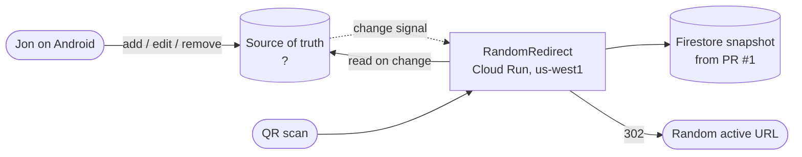
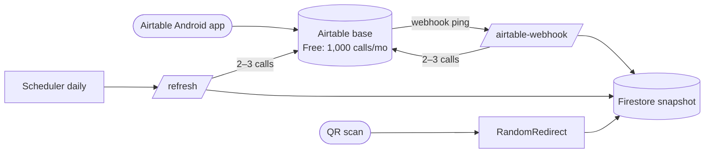
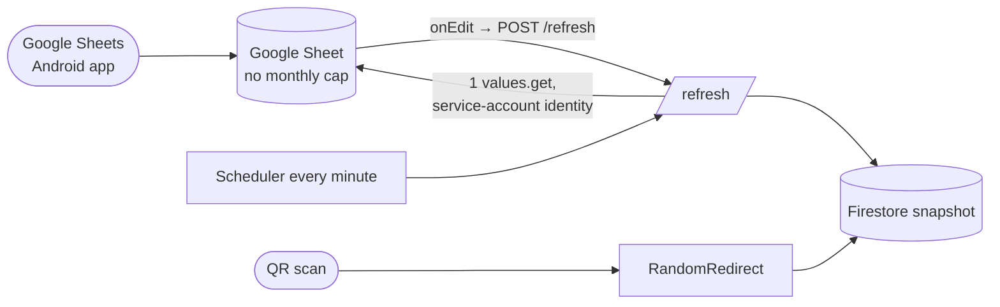
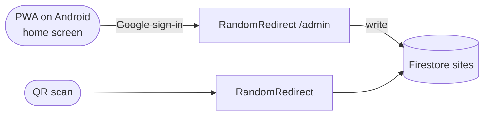
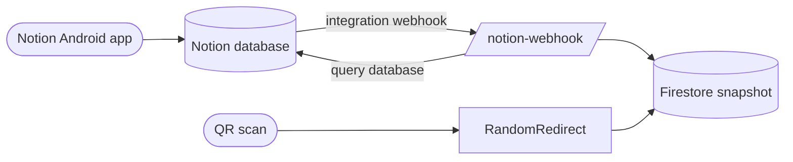

# AA: Replacing Airtable as the redirect list's source of truth

## Metadata

| Field | Value |
|---|---|
| Summary | Decide whether to keep Airtable or move the redirect list (Name, URL, Active) to another store. The deciding needs are editing records on the go from an Android phone, and never running out of API quota. |
| Created | 2026-10-21 |
| Status | READY FOR REVIEW |

## Background

`RandomRedirect` redirects each QR scan to a random active record. Records live in an Airtable table with three fields: `Name`, `URL` and `Active`. The [caching AA](airtable-cache.md) and PR #1 put a Firestore snapshot in front of Airtable, so scans no longer call Airtable at all.

While registering the webhook on 2026-10-21, Airtable returned `PUBLIC_API_BILLING_LIMIT_EXCEEDED`. That error means the workspace is on a plan with a **monthly API cap**. On Free, the cap is 1,000 calls per workspace, reset on the 1st, and the grace period is already spent ([Airtable: managing API call limits](https://support.airtable.com/docs/managing-api-call-limits-in-airtable)). This, not the 5 req/s per-base limit, is what was degrading the old function, which made one call per scan.

With PR #1 the budget is workable: about 2–3 calls per edit plus about 2 per day. That leaves roughly 300 edits a month. But the cap stays a hard ceiling that a burst of edits or a misconfiguration can hit. On Free, Airtable automations can't run scripts ([Airtable: automations overview](https://support.airtable.com/docs/automations-overview)), so there's no quota-free way to push changes.

**The person's main need:** an Android app to add, update and remove records on the go.

**Requirements.**

- **R1.** Comfortable add, edit and remove from an Android phone, including the `Active` toggle.
- **R2.** Edits reach redirects within seconds to about a minute.
- **R3.** No monthly API cap or rate limit that scans or normal editing can exhaust.
- **Constraints.** The QR URL stays the same (Cloud Run function). The data is tiny (tens to hundreds of rows). The budget is about $0.

### AA trigger check

| Trigger | Applies? |
|---|---|
| New technology | Yes, for every alternative except keeping Airtable |
| Cross-team impact | No |
| Data architecture change | Yes. The source of truth moves. |
| Hard-to-reverse decision | Maybe. Migrating back is a CSV export and import. |
| Structural refactoring | Maybe. The fetch client and change-notification route get swapped. |

### Context diagram

Every alternative keeps PR #1's Firestore snapshot on the scan path. The question is only what sits on the left of the diagram.

## Decision

**Replace Airtable with a Google Sheet (Alternative 2).** Edits come from the Google Sheets Android app. An Apps Script `onEdit` trigger pings the function's `/refresh` route, and a frequent scheduled reconcile backs it up. It scores 4.45 / 5 against 4.15 for keeping Airtable, and it ranks first in 100% of 10,000 randomised weightings (see Robustness).

The deciding factors:
- The Sheets API has no daily or monthly cap, only 300 reads per minute per project ([Sheets API limits](https://developers.google.com/workspace/sheets/api/limits)). That removes the problem that started this work.
- The function can read the sheet with its own Google identity, so no API key is needed.
- It reuses almost all of PR #1.

## Proposal

**Alternative 2: Google Sheet → Apps Script push → function → Firestore snapshot.**

1. **Sheet.** One tab with the columns `Name`, `URL` and `Active` (a checkbox). The initial data comes from Airtable's CSV export, imported into the sheet. The sheet is shared, view-only, with the function's runtime service account (`<number>-compute@developer.gserviceaccount.com`). No key file is needed.
2. **Function changes (on top of PR #1):**
   - Replace `internal/airtableapi` with a Sheets reader. One `spreadsheets.values.get` call returns the whole range.
   - Keep the Firestore snapshot, `/refresh`, the `REFRESH_TOKEN` check, the last-good fallback and the overlapping-refresh guard.
   - Remove `/airtable-webhook`, `cmd/registerwebhook` and the two webhook secrets.
   - Replace the Airtable secrets with `SHEET_ID`.
3. **Push.** An installable `onEdit` trigger in the sheet's Apps Script project calls `UrlFetchApp.fetch(URL + "/refresh", {method: "post", headers: {Authorization: "Bearer <token>"}})`. The token is kept in Script Properties. Edits reach redirects in about 1–3 seconds. Apps Script triggers are server-side. Whether they fire for edits made in the Android app should be confirmed in a 10-minute spike before cut-over; the reconcile below covers the case where they don't.
4. **Reconcile.** Sheets reads cost no quota at this volume, so Cloud Scheduler can call `/refresh` **every minute** instead of daily. That's about 43k Sheets reads a month, far under the per-minute limit. Even if `onEdit` never fires on mobile, the worst-case staleness is about 1 minute.
5. **Optional nicer phone UI.** If the spreadsheet grid feels fiddly on a phone, AppSheet can generate a form-style Android app over the same sheet with no code. That's a front-end change only, and nothing above depends on it.

**Setup Jon does himself:**
- Create the sheet and import the CSV.
- Share the sheet with the service account.
- Paste the Apps Script snippet and authorise it once.
- Add the `SHEET_ID` secret.
- Change the Scheduler job's schedule to `* * * * *`.
- Enable the Sheets API in the GCP project.

## Consequences

### Cost Estimate

Horizon: 6 months of development, 5–10 years of infrastructure. Development is Jon's time plus Claude-built code, so it's given in hours. Prices are list prices at the time of writing.

| | Option 1: Keep Airtable (PR #1) | Option 2: Google Sheet | Option 3: Firestore + own PWA editor | Option 4: Notion database |
|---|---|---|---|---|
| Dev effort | 0 h beyond PR #1 | ~2 h (code swap + spike + setup) | ~8–12 h (CRUD UI, auth, tests) | ~4 h (new client, webhook verification, migration) |
| Infra per month | $0 on Free (paid seat if upgraded to Team) | $0. The Sheets API is free within quota. Scheduler bills per job, not per run. | $0. Firestore free tier. | $0 on Notion Free |
| Infra over 10 years | $0 (or the price of a Team seat × 120 months) | ≈ $0 | ≈ $0 | ≈ $0 |
| **Total Cost** | **0 h, $0, capped** | **~2 h, ≈ $0** | **~10 h, ≈ $0** | **~4 h, ≈ $0** |
| **Cost Savings** vs. upgrading Airtable to Team to lift the cap | — | One Team seat per month, indefinitely | Same | Same |

### Positive Impacts

- There's no monthly API cap left to exhaust. Normal editing and scans can't break the function.
- Edits reach redirects in seconds, or about a minute at worst. That's better than PR #1's daily-reconcile fallback.
- The Google Sheets Android app is mature, works offline and syncs.
- The function reads the sheet with its own service account, so no third-party API key is stored. The webhook MAC secret and the PAT both go away.
- Simpler code: the webhook route, payload cursor and registration command are removed.

### Negative Impacts

- Editing is a spreadsheet grid on a phone, which is less polished than a dedicated form (AppSheet mitigates this).
- The sheet has no schema enforcement. A renamed column or a non-URL value has to be handled defensively in the reader.
- Whether Apps Script `onEdit` fires for Android-app edits is unverified. If it doesn't, propagation falls back to about 1 minute.
- Google has announced that Sheets API usage above quota will be billed later in 2026. Expected usage is about 1% of quota, but this should be watched.
- Migration means a CSV export and import, and anything else using the Airtable base (views, other automations) is left behind.

## Analysis

### Alternative 1: Keep Airtable (with PR #1's cache)

**Pros**
- Already built (PR #1). No migration.
- The Airtable Android app is a good form-style record editor.

**Cons**
- The monthly cap stays a hard ceiling (about 300 edits a month on Free). Once it's hit, refreshes stop until the 1st.
- Webhook expiry, a MAC secret and a payload cursor all have to be operated.
- The only way to lift the cap is to pay for a Team seat.

### Alternative 2: Google Sheet + Apps Script push (proposed)

**Pros**
- No monthly cap. Free. Fast push, plus a reconcile every minute.
- No stored third-party credential.
- Reuses PR #1, with net less code.

**Cons**
- A spreadsheet UI on a phone (AppSheet can fix that).
- No schema, so the reader must validate.
- `onEdit` on mobile needs verifying.

### Alternative 3: Firestore as the source of truth + a self-built PWA editor

**Pros**
- One system and no sync at all, so edits are live immediately.
- Fewest external dependencies.

**Cons**
- The editor, its authentication and its tests all have to be built and maintained. It's the most effort.
- It's a web app pinned to the home screen, not a native app, with no offline editing unless that's built too.
- Getting authentication wrong would expose the redirect list to tampering.

### Alternative 4: Notion database

**Pros**
- No monthly API cap (rate limited to about 3 req/s on average).
- A native Android app.

**Cons**
- Notion databases on a phone are heavier to edit than a form or a sheet.
- A new API, webhook signing and migration; it's essentially Airtable again with different tradeoffs.
- Webhook delivery latency is less predictable.

### Rejected without full scoring

- **Baserow, NocoDB, Grist (hosted):** no native Android app, only the mobile web. Self-hosting adds a server to run.
- **Cloudflare D1/KV plus a custom app:** the same build effort as Alternative 3, plus a second cloud.
- **A native Android app (Kotlin) over Firestore:** the most effort, plus a Play Store or sideloading workflow for one user.

### Decision Matrix

Scores are integers 1–5, where 5 is always the most desirable. Cost, effort and lock-in are inverted so that a lower raw value scores higher. Weights sum to 1.00. The weighted total is Vⱼ = Σ(Wᵢ × Sᵢⱼ).

| Evaluation Criteria | Group | Weight | Alt 1: Keep Airtable | Alt 2: Google Sheet | Alt 3: Firestore + PWA | Alt 4: Notion |
|---|---|---|---|---|---|---|
| C1. Android add, edit and remove experience (R1) | Functional fit | 0.25 | 4 | 4 | 3 | 3 |
| C2. Edit propagation latency (R2) | Functional fit | 0.15 | 5 | 5 | 5 | 4 |
| C3. Quota headroom: no cap that use can exhaust (R3) | Functional fit | 0.15 | 4 | 5 | 5 | 5 |
| C4. Ongoing cost (inverted) | Business | 0.10 | 5 | 5 | 5 | 5 |
| C5. Migration and implementation effort (inverted) | Business | 0.10 | 5 | 4 | 2 | 3 |
| C6. Reliability and failure modes | Quality | 0.07 | 3 | 4 | 5 | 4 |
| C7. Security: credentials and editing auth | Quality | 0.05 | 4 | 5 | 3 | 4 |
| C8. Day-2 ops (moving parts) | Operational fit | 0.08 | 3 | 4 | 4 | 3 |
| C9. Lock-in and reversibility (inverted) | Operational fit | 0.05 | 3 | 4 | 3 | 3 |
| **Total Weighted Score** | | **1.00** | **4.15** | **4.45** | **3.92** | **3.77** |

Alt 1's C3 score of 4 assumes PR #1 is deployed. Without the cache, the old one-call-per-scan design scores 1.

#### Score anchors

| Criterion | 1 | 3 | 5 |
|---|---|---|---|
| C1 | Desktop only, or a mobile web page that's barely usable | Usable native or PWA editing with some friction (grid, nested pages, no offline) | Native app with comfortable record editing and offline sync |
| C2 | Hours or a manual refresh | Within a few minutes | Within seconds, with a reconcile of a minute or less as backstop |
| C3 | A cap that normal use exhausts | A cap that only abnormal use exhausts | No monthly cap; per-minute limits far above use |
| C4 | More than $20/month | A few $/month | $0 |
| C5 | More than 10 h or a rewrite | 3–5 h | Already done or under 1 h |
| C6 | Silent staleness when one component fails | Fails safe with a manual fix | Self-healing with no single fragile link |
| C7 | New long-lived third-party keys plus home-grown auth | One stored third-party token | No stored third-party credential; platform identity only |
| C8 | Several services across vendors | Several components from one vendor | One or two components |
| C9 | Proprietary format, migration needs code | Export is easy but the integration is vendor-specific | Plain CSV in and out, thin integration |

Scores of 2 and 4 fall between the neighbouring anchors.

#### Robustness

All figures come from [`replace-airtable-robustness.py`](replace-airtable-robustness.py). It uses seed `20261021`.

**1. Dominance.** Nothing dominates. Alt 2 is at least as good as Alt 1 everywhere except C5 (effort: 4 vs. 5). Alt 3 beats Alt 2 on C6.

**2. Winning margin.** Alt 2 leads Alt 1 by Δ = **0.30**. Normalised, Δ̄ = 0.30 / 4 = **0.075**. That's at or above 0.05, so the margin **isn't close**.

**3. Flip points** (Alt 2 vs. Alt 1, with the other weights renormalised):

| Criterion | Wₖ | dₖ | δₖ | Weight at which Alt 1 takes the lead | \|δₖ\| / Wₖ |
|---|---|---|---|---|---|
| C1, C2, C4 | 0.25 / 0.15 / 0.10 | 0 | — (cannot flip) | — | — |
| C3. Quota headroom | 0.15 | +1 | −0.364 | infeasible | — |
| C5. Effort | 0.10 | −1 | +0.208 | 0.308 | 2.08 |
| C6, C7, C8, C9 | 0.07 / 0.05 / 0.08 / 0.05 | +1 | −0.39 to −0.41 | infeasible | — |

The only flip that's possible is to make effort (C5) at least 0.31, three times its weight. In other words, Airtable wins only if avoiding about 2 hours of migration matters more than anything else.

**4. Monte Carlo** (10,000 trials per method, scores fixed):

| Sampling method | Alt 1 | Alt 2 | Alt 3 | Alt 4 |
|---|---|---|---|---|
| Each weight moved independently by up to ±20% of its base value | 0.0% | **100.0%** | 0.0% | 0.0% |
| Dirichlet distribution centred on the base weights, α = 100 · W | 0.0% | **100.0%** | 0.0% | 0.0% |

**5. Interpretation.** Alt 2 is **robust**. It wins every trial, and no single weight change short of tripling the effort weight reverses it.

The judgement that could most change the outcome is C1. If Jon finds Sheets on a phone clearly worse than the Airtable app (Alt 2's C1 at 3), the totals become Alt 2 4.20 and Alt 1 4.15. Alt 2 still leads, but only just, and AppSheet would be the fix. That's worth testing for a day before migrating.
